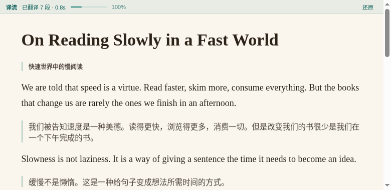

# 译流 TransFlow

> 快速、开源的双语阅读层。整页双语、划词、输入框翻译，默认接入国内低延迟渠道。
>
> GitHub：<https://github.com/shixiuhai/transflow> · 下载：<https://github.com/shixiuhai/transflow/releases>
>
> **单词本同步说明**：启用同步后，你主动加入单词本的词条会发送到**作者自建的同步服务器** `transflow.yizhiweb.top`，仅用于跨设备恢复（不是翻译代理）。该服务是个人简单实现，**不保证稳定性、可用性或永久存储**；重要词库请定期用「导出 JSON」备份。



**状态：v1.13.0。** 真实火山链路已验证（首段 875ms / 整页 877ms，7 段 fixture）；35 项自动化冒烟全绿（含设置导航/单词本/复习/管理页）；火山 / 百度 / OpenAI 兼容 / Mock 四类渠道，整页四种样式、区块级配色、缓存、术语表、用量、首次向导均已可用。

## 为什么做它

- **快**：视口顺序、批量请求、同页去重、缓存命中即时渲染。
- **融合**：译文继承页面排版与配色，深色区块单独取色，不像外挂面板（Fusion UI）。
- **开箱即用**：默认火山引擎（每月前 200 万字符免费），3 步向导完成配置。
- **真正开源**：MIT、无账号、无遥测、翻译密钥只存本机；单词本同步是可选的作者自建服务。

## 功能

- **整页双语**：块级渲染（译文是原文的 sibling，不重写 DOM），视口优先，去重，取消/还原。
- **四种样式**：融入（左细线）/ 轻卡片 / 遮罩（悬停显形）/ 仅译文；按区块背景自动取色。
- **划词**：默认选中后按 **小写 `t`**（也可录 `r` 或组合键），译文直接出现在选区旁边；也可用浮标 / `Alt+S` / 右键。支持同源/跨域 iframe 内划词（邮件正文、预览页）。
- **输入框**：双击空格或 `Alt+D` 原地翻译，`⌘/Ctrl+Z` 撤销。
- **术语表**：`原文=译文`，翻译前占位符保护、译后还原。
- **用量**：本机统计本月字符；火山引擎可查**官方账单实付**与机器翻译计费（需 BillingCenterReadOnlyAccess）；OpenAI 官方可查 token/费用（Admin key）；DeepSeek 可查官方余额。
- **单词本**：气泡/弹窗「＋单词本」，UUID 跨设备恢复，默认每 6 小时自动同步 + 手动立即同步。
- **复习**：独立的间隔重复复习页（认识/模糊/不认识/很简单），今日目标、间隔预览、`Z` 撤销、`Space` 翻面/认识。
- **统一设计系统**：设置/词库/复习/弹窗共用暖纸 + 墨绿 tokens，浅色/深色一致，不再一个页面全黑一个页面冷灰。
- **单词本管理**：独立管理页，支持搜索/状态/标签筛选、排序、分页、编辑、批量删除、复制、手动添加、导入 JSON、导出 JSON/CSV、同步与 UUID 恢复；设置页顶部常驻「复习 / 单词本管理 / 同步」和 5 个分组 tab。
- **气泡样式**：暖纸（默认）/ 跟随页面 / 毛玻璃 / 高对比，四种阅读风格。
- **渠道**：火山引擎（默认）、百度高级版、OpenAI 兼容（DeepSeek/GLM/Qwen）、本地 Mock。

## 安装与更新

- 推荐安装 `transflow-<version>.crx`（稳定 ID，后续拖新 CRX 即更新）。
- 或加载已解压的 `.output/chrome-mv3`；更新时替换同一目录并点“重新加载”。
- 详细说明与一次性迁移见 [docs/UPDATE.md](docs/UPDATE.md)。

## 快速开始

```bash
pnpm install
pnpm dev        # 开发模式（自动打开 Chrome）
pnpm build      # 产物：.output/chrome-mv3
```

加载：`chrome://extensions` → 开发者模式 → 加载已解压的扩展程序 → 选择 `.output/chrome-mv3`。

首次点击图标会进入 3 步向导：选渠道 → 填密钥 → 选目标语言。

## 配置渠道

| 渠道 | 免费额度 | 获取密钥 |
|---|---|---|
| 火山引擎（推荐） | 每月前 200 万字符 | https://console.volcengine.com/iam/user |
| 百度翻译高级版 | 每月 100 万字符 | https://fanyi-api.baidu.com/access/0/1 |
| OpenAI 兼容 | 按 token | 任意兼容端点 + model |

火山：注册 → 实名 → 开通机器翻译 → 建子用户（编程访问）→ 授权 `TranslateFullAccess` → 创建 AK/SK。

密钥只写入 `chrome.storage.local`，不上传。命令行自检：

```bash
mkdir -p ~/.secrets && chmod 700 ~/.secrets
printf 'VOLC_AK=%s\nVOLC_SK=%s\n' 'AK' 'SK' > ~/.secrets/volc.env
chmod 600 ~/.secrets/volc.env
pnpm volc:check
```

## 真实渠道验证

```bash
pnpm volc:check   # 直连 API + 两句样例
pnpm volc:bench   # 单段 / 16 段批量延迟
pnpm volc:e2e     # 扩展端到端（需要 Chrome for Testing）
```

## 开发与测试

```bash
pnpm typecheck   # tsc --noEmit
pnpm test        # 34 个单元/契约测试
pnpm smoke       # 24 项端到端冒烟（Chrome for Testing）
pnpm zip         # 可安装 zip
```

`pnpm smoke` 会启动 fixture、加载扩展、通过 service worker 触发翻译，断言：整页/配色/还原/缓存/四种样式/输入框/撤销/术语表/用量/无密钥错误/向导/长页上限/Popup/划词/取消/429/慢请求取消，并截图到 `/tmp/tf_page.png`。需要支持 `--load-extension` 的 Chrome for Testing，可用 `CHROME_BIN` 指定。

- [冒烟矩阵](docs/SMOKE.md)
- [性能基准](docs/PERF.md)
- [渠道说明](docs/PROVIDERS.md)
- [架构](docs/ARCHITECTURE.md)
- [发布清单](docs/RELEASE.md)
- [拿到 key 后验证](docs/VERIFY-WITH-KEY.md)
- [贡献指南](CONTRIBUTING.md) · [安全](SECURITY.md) · [变更日志](CHANGELOG.md)

## 架构

```
Popup / Options (React) ──runtime messages──▶ Background (Service Worker)
                                                │ provider registry + V4/MD5 signing
                                                ▼
                                      Volc / Baidu / OpenAI / Mock

Content (per page)
  collect blocks → dedupe → batch → cache ──▶ provider
  render .tf-block (blend|card|mask|replace)
  ambient bar · selection bubble · input-box translation
```

- 纯逻辑在 `src/core/`，可单测；浏览器相关只在 `entrypoints/`。
- 注入 UI 用 Shadow DOM；译文块用 `contain: content`，不参与原 DOM 布局。
- 缓存键 `provider|from|to|hash(text)`，TTL 30 天，整页 bulk 读取。

## 快捷键

- `Alt+S` 翻译选中文本
- `Alt+A` 翻译整页 / 还原
- `Alt+D` 翻译输入框

可在 `chrome://extensions/shortcuts` 修改。

## 隐私

不收集遥测、无账号、无自建服务器；译文只发送到你选择的渠道；密钥与缓存均在本机。详见 [PRIVACY.md](PRIVACY.md) 或 [在线隐私政策](https://shixiuhai.github.io/transflow/privacy.html)。

## 许可

MIT
